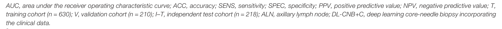
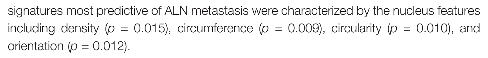
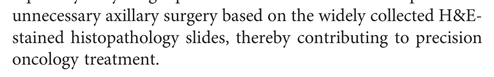

# MinerUPlus

[English](README.md) | 中文

**面向 AI agent 的论文 PDF 解析器，自带核对。**
它把解析出的每一个词和 PDF 的文本层、以及第二个读取器对页面图像的独立读法逐词比对。证据足以定下的错误，它写回正文，并记下每处改动的依据。定不下来的，它交还给调用方，每条都附页码、两种读法和页面截图。

agent 引用论文原文、抽样本量和 p 值、从图表建数据集时，需要知道 markdown 里哪些地方可信。现有解析器只给一份读出来的结果，不说哪里可能错。MinerUPlus 连同这份说明一起给。

---

## 一次真实运行

论文：Xu 等，*Predicting Axillary Lymph Node Metastasis in Early Breast Cancer Using Deep Learning on Primary Tumor Biopsy Slides*，Frontiers in Oncology 2021（[doi:10.3389/fonc.2021.759007](https://doi.org/10.3389/fonc.2021.759007)，CC BY 4.0），共 11 页。这次运行的全部文件都在 [`examples/frontiers_bcnb/`](examples/frontiers_bcnb/)。读取器的原始 markdown 和最终结果放在一起，可以逐行对照。

**样本量。** 这里读取器把数字读错了：



| | 文本 |
|---|---|
| MinerU（advanced） | `V, validation cohort $( n = 2 7 0 ) ; 1 - T ,$ independent test cohort $( n = 2 7 8 ) ; A L N ,$` |
| MinerUPlus | `V, validation cohort $( n = 210 ) ; I - T ,$ independent test cohort $( n = 218 ) ; A L N ,$` |

- `270 → 210`、`278 → 218`：第二读取器（OXR）的读法和 MinerU 不一致，判定器确认截图上印的正是 `210` 和 `218`。
- `1 → I`：由文本层定下。
- 数字里的空格也去掉了，现在搜 `n = 210` 能搜到。

**p 值被读成 ρ。**



| | 文本 |
|---|---|
| MinerU（advanced） | `density $\langle \rho   =   0 . 0 1 5 \rangle$ , circumference $\left( \rho   =   0.009 \right)$ , circularity $\langle p   =   0 . 0 1 0 \rangle$ , and orientation $\langle \rho = 0 . 0 1 2 \rangle$` |
| MinerUPlus | `density (p = 0.015) , circumference $\left( p = 0.009 \right)$ , circularity (p = 0.010) , and orientation (p = 0.012).` |

这处由几项核对一起改对。`ρ → p` 一部分来自读页判定器看截图，一部分来自文本层。读取器漏掉的括号和句末句号，文本层里有；判定器确认它们确实印在页面上，其中三个公式按文本层重写。

**它留给调用方的地方。**



MinerU 读成 `Estained`，OXR 读成 `E - stained`，页面上印的是跨行的 `H&E-stained`。截图把两行都截进来了。这次运行里，读页判定器在两种选项顺序下给出的答案不一致，所以没有写回，这一处作为未决问题附截图交给调用方（[`issues.json`](examples/frontiers_bcnb/issues.json)）。这篇论文跑了 9 次，有 7 次判定器选了 OXR 的读法，写成了 `H&E-stained`。

**报告**（[`report.md`](examples/frontiers_bcnb/report.md)）开头是这样的：

```
# mineru_plus 0.5.6 — frontiers_bcnb.pdf

11 pages; every page has a text layer.
Readers: oxr, mineru.
Figure transcriptions: 4 (figures.json), 4 moved out of full.md; 0/215 of their tokens are printed in the figure's ...

## Measured on this document
- dropped: 7 places where the text layer has characters the primary lacks: jev reads the layer's form on the page ...
- reflow: 11 paragraphs end mid-sentence before the next text block: 8 joined with their continuation (1 with figu ...
- tables: 2 tables checked against the text layer cell by cell: 3 look-alike characters and 0 spaces between a cel ...
- characters: 8806/8903 primary tokens agree with OXR; 29 corrections written (3 line-break spellings), 2 left ope ...
- formula_spacing: 25 formulas respelled without the spaces LaTeX ignores ('0 . 0 1 5' as '0.015', '\mathrm { A U ...
...
## Not checked
- page headers, footers and page numbers: checked against the text layer only (coverage); a broken layer there is ...
- figure transcriptions beyond the printed labels (figures.json): the reader's estimate

## Open issues: 1 (issues.json)
```

报告后面还列出本次运行用的后端，以及每项核对的校准数据。

---

## 为什么要做

现在的文档解析器靠视觉模型读页面图像。在原生电子版论文上，出错的结果看上去和正确文本一模一样：

| 失败类型（实测中遇到的） | 例子 | 对 agent 的影响 |
|---|---|---|
| 行内公式里的字符读错 | `µm` 读成 `pm`，`ANC` 读成 `ANN`，`156` 读成 `I56`，`χ2` 读成 `X^2` | 抽出来的单位和数值是错的 |
| 数字写成带空格的 LaTeX | `$( n = 2 1 0 )$` | 搜 `n = 210` 搜不到 |
| 读取器漏掉的文字 | 页脚里的斜体期刊名、作者单位行 | 引文无法和原文核对 |
| 模型"纠正"了印刷错字 | 原文印 `microevironment`，输出 `microenvironment` | 逐字引文和原文对不上 |
| 浮动体打断阅读顺序 | 一句话被图隔开，隔两个块才接上 | 断句、图注混进正文 |
| 图的转写混进正文 | 图表标签和模型的猜测夹在正文里 | 没核对过的内容被当成正文 |

这些都不会报错，输出看起来是完整的。

## 做了什么

```
            PDF
             │
   ┌─────────┼──────────────┐
   ▼         ▼              ▼
 主读取器   第二读取器       PDF 文本层
 (MinerU)  (只看页面图像)    (原生电子版页面)
   │         │              │
   └──── 逐页、逐词比对 ─────┘
                │
   两种读法不一致、漏字、第二读取器没读到的文字、表格、公式、断句
                │
   先用证据定：文本层（精确上下文 → 本页词 → 全文用法）
   证据定不了，再让判定器看页面截图：两种选项顺序都问，答案一致才算定
                │
   ┌────────────┴─────────────────────┐
   ▼                                  ▼
 定下的：写回 full.md，              没定下的：写进 issues.json，
 每处改动连同依据记在                附页码、两种读法和页面截图
 checks/edits.json
   │
 验收：修过的 markdown 和原文的词多重集之差，必须正好等于各处改动声明的词
```

设计原则：
- **证据先于判定器**：文本层能定的，不问模型。
- **判定器只答封闭题，而且看的是页面图像**：每题两种选项顺序各问一次，两次一致才算定下。
- **判定器只看核过的截图**：截图位置由文本层定，然后先问判定器这张图是否完整显示了这段文字（前 2 个词、有争议的部分、后 2 个词）。不通过就扩大再问；没有一张通过，这一处就不判，作为未决问题交还。37 篇论文的 396 处里，380 张截图通过；没通过的 16 处大多本来就没东西可截（页面上不印的符号、图里的文字）。
- **"定不了"是合法答案**：它附截图交还给调用方，不去猜。
- **没查的也说**：图里文字以外的内容、没有文本层的页面，都写进报告的"未核对"一节。

## 输出

输出里的 `jev` 指判定器，`Gemini` 指读页判定器，沿用的是我们所用组件的名字。

一个 PDF 输入，一个目录输出：

| 文件 | 内容 |
|---|---|
| `full.md` | 解析结果：主读取器的读法，写入了已定下的修正，图的转写已移出 |
| `issues.json` | 没定下的地方，交给调用方：类型、页码、两种读法、截图路径 |
| `report.md`、`report.json` | 本次运行的质量说明：比对了什么、改了什么、什么没查，以及各工具的校准数据 |
| `sections.json` | 章节：标题、层级（按标题编号的深度定）、页码范围 |
| `quote_index.json` | 每节原文和去空白后的版本，供逐字核对引文 |
| `figures.json` | 图和图表的转写；哪些是页面上印出的字，哪些是读取器的估计 |
| `checks/` | 每处不一致的处理路径、判定和依据；`edits.json`；判定器的请求和截图 |
| `readers/` | 两个读取器的原始输出，未经改动 |

## 和同类产品的比较（截至 2026-10-30）

MinerUPlus 不是识别模型，它调用读取器（MinerU），再核对读取器的输出。所以下面比的是：**各工具对自己的输出告诉调用方什么**。识别精度是另一回事：在 [OmniDocBench](https://github.com/opendatalab/OmniDocBench) 上，MinerU、PaddleOCR-VL 等 VLM 读取器都在前列，彼此相差不大。

**这类错误上游也承认。** MinerU 维护者写过 VLM "may occasionally generate hallucinations"（[#4147](https://github.com/opendatalab/MinerU/issues/4147)：印的 "prefill" 输出成 "prefetch"）。还有公式里的字符被换掉、而文本层是对的（[#5646](https://github.com/opendatalab/MinerU/issues/5646)：`LiTMO2` → `LiTiO2`）。这两个 issue 都没有给调用方任何办法，把这些地方和其余输出区分开。

现有工具在文本之外还交给调用方什么：

| 工具（版本，日期） | 用 PDF 文本层 | 置信度 | 自检输出 | 交还未决之处 | 记录修正 |
|---|---|---|---|---|---|
| **开源** | | | | | |
| [MinerU](https://github.com/opendatalab/MinerU) 4.1.2（2026-10-29） | `flash` 档以文本层为文字来源（[tiers](https://opendatalab.github.io/MinerU/usage/tiers/)）；其他档文档未说明 | – | – | – | – |
| [Docling](https://github.com/docling-project/docling) 2.145（2026-10-29） | 用，用于程序生成的 PDF | 每页给出解析、版面、表格、OCR 四项分数，都来自它自己的模型（[文档](https://github.com/docling-project/docling/blob/main/docs/concepts/confidence_scores.md)） | – | – | – |
| [Marker](https://github.com/datalab-to/marker) 2.1.0（2026-10-29） | 用：用 pdftext 抽文字；表格按文本层重建，重建置信度低时回退到 VLM | 仅内部使用（表格回退） | – | – | – |
| [olmOCR](https://github.com/allenai/olmocr) 0.4.27（2026-03-12） | v1 把文本层放进提示词（"anchor text"）；新模型"not used" | – | – | – | – |
| [PaddleOCR-VL](https://github.com/PaddlePaddle/PaddleOCR)、[DeepSeek-OCR 2](https://github.com/deepseek-ai/DeepSeek-OCR)、[MonkeyOCR v2](https://github.com/Yuliang-Liu/MonkeyOCR)、[dots.mocr](https://github.com/rednote-hilab/dots.ocr)、[OXR](https://github.com/SoMarkAI/OXR) | 未说明 | 未说明 | – | – | – |
| **闭源** | | | | | |
| [LlamaParse](https://developers.llamaindex.ai/llamaparse/changelog/2026-07/) | – | 页级 | **有，2026-07-15 起**：多一轮复核给自己的输出打分；拿什么对照，文档未说明 | – | – |
| [Mistral OCR](https://docs.mistral.ai/capabilities/document_ai/basic_ocr) | – | 页、块或词三级（`confidence_scores_granularity`） | – | – | – |
| [Azure Document Intelligence](https://learn.microsoft.com/en-us/azure/ai-services/document-intelligence/concept/accuracy-confidence)、[Google Document AI](https://docs.cloud.google.com/document-ai/docs/handle-response)、[AWS Textract](https://docs.aws.amazon.com/textract/latest/APIReference/API_Block.html) | – | 词级或块级（0–1；Textract 为 0–100） | – | – | – |
| [Reducto](https://docs.reducto.ai/parse/overview) | – | 块级（如 `"high"`） | – | – | – |
| **MinerUPlus** | 每个词都和文本层核对 | –（改为说明查了什么、改了什么、什么没查） | 文本层 + 独立的第二读取器 + 判定器看页面截图 | `issues.json`，每条附页面截图 | `checks/edits.json`，每处附依据 |

"–" 表示该工具现行文档里没有这项功能；"未说明" 表示我们没找到任何说法。

小结：

- **置信度已经很普遍**，闭源服务尤其如此。但它是模型对自己读法的估计：一个置信度很高的误读，看起来和正确的读法没有区别。
- **自检已经出现**（LlamaParse，2026 年 7 月）。但文档没说拿什么来对照，给出的也只是分数，不是一份位置清单。
- **我们没找到哪个工具同时做到这三点**：
  - 拿独立证据核对输出：PDF 自带的文本层，加上第二读取器；
  - 印刷错字按原样保留，不让模型去改；
  - 把定不下来的地方附页面截图交还，让 agent 能直接处理。

基准测试也在往这个方向走。[ParseBench](https://arxiv.org/abs/2604.08538)（2026 年 4 月）面向 AI agent，按内容忠实度和视觉定位给解析器打分，不比文本相似度。它的结论是 "no method is consistently strong across all five dimensions"。

## 目前的实测

数字来自我们自建的测试集：英文的生物医学和计算机论文，全部是原生电子版。这不是 benchmark。

- **字符错误召回**：在 9 篇论文 18 页的文本层里人为埋了 216 个错误。191 个作为不一致被找出来；其中判定器选了页面印出那一边的有 182 个，选错 0 个。
- **读页判定器**：106 题，含 34 个印刷错字、12 处真实不一致、60 个人为埋入的错误。判定器定下的题里，错 0 个；没定下的 18 个转成 issue。
- **第二读取器**：9 篇论文共埋了 203 个错误。OXR 找出 187 个，MiniCPM-OCR 找出 186 个，两个合起来 188 个，所以一个第二读取器就够。但不能没有：只用判定器、不用第二读取器时，有 36% 的正确行被判错。
- **留出集**：6 篇开发时没用过的论文，验收 6/6 通过。比对了 87,624 个词，其中 83,338 个和第二读取器一致。
- **耗时**：一篇 27 页的论文约 4 分钟。两个读取器约占 2 分 40 秒，核对约 1 分钟。

完整的校准数据写在每份 `report.md` 里。

## 局限

- **最适合原生电子版 PDF。** 扫描页没有文本层，只剩第二读取器和判定器两道核对。报告会列出这些页。
- **图里的内容不核对**，文本层里印出的标签除外。
- **独立公式**按规范化后的 LaTeX 比对。上下标叠排、分式这类复杂结构不重写。
- **比单个读取器慢**：PDF 要读两遍，还要调用判定器。

## 依赖

- Python ≥ 3.10，`pymupdf`，`pillow`（`pip install .`）
- 四个外部组件，每个角色一个，在配置文件里选择。满足该角色要求的任意实现都可以接：

| 角色 | 要求 | 可选后端 |
|---|---|---|
| `primary_reader` 主读取器 | 逐页给出带坐标、带块类型的结构化输出（MinerU 4.x 的 `structured_content.json`） | `mineru_kit`（`mineru-kit` 命令行），`command`（任意能写出约定文件的程序），`gateway` |
| `second_reader` 第二读取器 | 只读页面**图像**，不读文本层。检验办法：埋一层伪造的隐藏文本层，合格的读取器必须印出页面上实际显示的字 | `openai_vlm`（任意 OpenAI 兼容的视觉模型），`command`，`gateway` |
| `decision_judge` 判定器 | 多模态；做封闭选择题，给出各选项的概率 | `openai`（任意 OpenAI 兼容端点），`gateway` |
| `page_judge` 读页判定器 | 多模态；照字面读字符，不自动纠正印刷错字 | `openai`，`agy`（能读图像文件的命令行 agent） |

各后端必须写出的文件格式，见 `mineru_plus/backends/__init__.py`。后端怎么部署由使用者自定。

### 我们用的组件

本文的所有结果都出自这套配置：

| 角色 | 组件 | 公开来源 |
|---|---|---|
| `primary_reader` | MinerU 4.0.12，advanced 档 | [opendatalab/MinerU](https://github.com/opendatalab/MinerU) |
| `second_reader` | OXR 1.0 | [SoMarkAI/OXR](https://github.com/SoMarkAI/OXR) |
| `decision_judge` | d3-ultra（System One 协议） | [vllm-sr/d3-ultra](https://huggingface.co/vllm-sr/d3-ultra) |
| `page_judge` | Gemini 3.8 Flash，thinking high | Gemini API |

前三个经我们自己的工具网关调用（`gateway` 后端，配置见 `config.gateway.example.json`），Gemini 经命令行 agent 调用（`agy` 后端）。

## 配置

把 `config.example.json` 复制成 `mineru_plus.json`，填上你自己的服务：

```json
{
  "primary_reader": {"backend": "mineru_kit", "command": "mineru-kit", "tier": "standard"},
  "second_reader":  {"backend": "openai_vlm", "base_url": "http://localhost:8000/v1", "model": "your-vision-model",
                     "api_key_env": "SECOND_READER_KEY"},
  "decision_judge": {"backend": "openai", "base_url": "https://api.example.com/v1", "model": "your-model",
                     "api_key_env": "JUDGE_KEY"},
  "page_judge":     {"backend": "openai", "base_url": "https://api.example.com/v1", "model": "your-vision-model",
                     "api_key_env": "JUDGE_KEY"}
}
```

配置文件里不写密钥：`api_key_env` 填的是存放密钥的环境变量名。查找顺序：`--config PATH`，其次 `$MINERU_PLUS_CONFIG`，最后是当前目录下的 `./mineru_plus.json`。没配第二读取器也能跑完，报告会写明字符没有核对。

## 用法

```bash
pip install .
mineru-plus paper.pdf out/ --config mineru_plus.json
```

命令会打印 `report.md` 并写出输出目录。读取器的输出缓存在 `out/readers/`，判定器的回答按题目哈希缓存，重跑时只问改动过的题。

## 路线图

- [ ] 把 MinerU 误包成公式的正文还原成纯文本（例如 `$( n = 210 ) ; I - T ,$`）
- [ ] `sections.json` 里排除期刊横幅、"Edited by" 这类前置信息框

## 许可证

Apache-2.0（见 `LICENSE`）。`mineru_plus/check/confusables.txt` 取自 Unicode TR39 数据，适用 [Unicode License](https://www.unicode.org/license.txt)。
